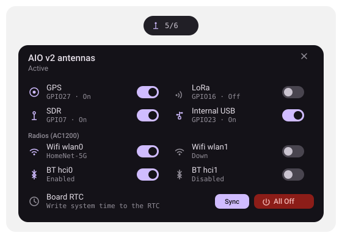

# AIO Antenna Control

A bar widget for the ClockworkPi uConsole running with a
[Hackergadgets AIO v2](https://hackergadgets.com/products/uconsole-aio-v2)
expansion board, with implementations for two different shells:
[DankMaterialShell](https://github.com/AvengeMedia/DankMaterialShell) (in
[`dank/`](dank/)) and [Omarchy](https://omarchy.org/)'s own `omarchy-shell`
(in [`omarchy/`](omarchy/)). Both add a bar pill with a popout to
enable/disable the board's GPS, LoRa, SDR, and internal-USB power rails, the
wifi and Bluetooth radios on a
[Hackergadgets AC1200 USB-C module](https://hackergadgets.com/) plugged into
that internal USB header, and sync the board's hardware RTC. The backend
logic (pins, commands) is identical between the two; only the QML/UI layer
differs to match each shell's own look and feel.

## Preview



This is a hand-drawn mockup of the `dank/` layout, not a screenshot — it
hasn't been run against real DankMaterialShell/hardware. The `omarchy/`
version, by contrast, has been smoke-tested live against a real
`omarchy-shell` instance (see [Omarchy install](#omarchy) below) — the
popout genuinely renders using `qs.Ui`'s `Panel`/`Toggle`/`PanelHero`
components and picked up this machine's real wifi/Bluetooth state
correctly. Neither has real AIO v2 GPIO hardware to test against, so the
`pinctrl` pin numbers/behavior are still only guide/forum-sourced for both.

## How it works

The AIO v2 gates GPS/LoRa/SDR/internal-USB power behind GPIO lines that are
off by default. They're driven directly with `pinctrl` (BCM numbering,
active-high — pull the pin high to enable):

| Feature      | GPIO |
|--------------|------|
| GPS          | 27   |
| LoRa         | 16   |
| SDR          | 7    |
| Internal USB | 23   |

```sh
pinctrl 27 op   # set as output
pinctrl 27 dh   # drive high -> on
pinctrl 27 dl   # drive low  -> off
pinctrl 27 get  # read current level
```

These pins/commands come from the
[Hackergadgets uConsole AIO V1/V2 setup guide](https://hackergadgets.com/pages/hackergadgets-uconsole-rtl-sdr-lora-gps-rtc-usb-hub-all-in-one-extension-board-setup-guide)
and the [ClockworkPi forum thread](https://forum.clockworkpi.com/t/uconsole-aio-v2-rtl-sdr-lora-gps-rtc-usb-hub-usb-3-0-rj45-ethernet/20800) —
**verify them against your own board revision before relying on this**, since
they weren't confirmed against the physical hardware.

Hackergadgets also publish an official control tool,
[`aiov2_ctl`](https://github.com/hackergadgets/aiov2_ctl), which wraps the
same `pinctrl` calls (confirmed identical GPIO_MAP: GPS=27, LORA=16, SDR=7,
USB=23) plus persistent boot-rail state, LoRa/Meshtastic service coupling,
and power monitoring. This widget talks to `pinctrl`/`iw`/`rfkill`/`hwclock`
directly instead of wrapping `aiov2_ctl`, to keep the dependency surface
small and not require it to be installed.

Deliberately **not** implemented: boot-time rail persistence (`aiov2_ctl
--boot-rail`). Every rail starts off after a reboot and you turn on what you
need — simpler, and nothing here needs to survive a power cycle unattended.

### Permissions

`pinctrl` needs access to `/dev/gpiomem`. On Raspberry Pi OS the default user
is already in the `gpio` group, which is normally enough — no `sudo`
required. If toggles silently fail, check `groups $USER` and that
`pinctrl <pin> get` works from a plain terminal first.

### Wifi radios (AC1200)

The AC1200 module exposes **two** wifi interfaces rather than one, so the
widget doesn't assume a single interface — it enumerates everything under
`/sys/class/net/*/wireless` on every poll and shows one toggle row per
interface it finds, with live up/down and SSID state parsed from `iw dev
<iface> link`. Toggling brings the interface up/down via `ip link set
<iface> up|down`; it does not manage NetworkManager connections/SSIDs, only
the radio's link state.

If your system also has an onboard wifi radio unrelated to the AC1200,
exclude its interface name (e.g. `wlan0`) via the "Wifi interfaces to
ignore" plugin setting so it doesn't show up as a third row.

### Bluetooth (AC1200)

The module also exposes **two** Bluetooth adapters. These are enumerated via
`rfkill list bluetooth` (parsing `Soft blocked`/`Hard blocked` per `hciN`
entry) and toggled with `rfkill block <index>` / `rfkill unblock <index>` —
the standard software radio kill-switch, same mechanism as airplane mode.
This only flips the radio on/off; it doesn't manage pairing or connections.
A `Hard blocked` adapter (a physical kill switch, not applicable on this
board) can't be re-enabled from software, so its row is shown but disabled.

### RTC sync

The AIO v2 also carries a hardware RTC. The "Board" section has a one-shot
"Sync" button that writes the current system time to it via `hwclock -w`
(same operation as `aiov2_ctl --sync-rtc`) — only useful after system time is
already correct (e.g. via NTP), so the RTC can keep time across power-offs
when there's no network to re-sync from on boot.

`hwclock -w` needs root. The widget runs `pkexec hwclock -w` if `pkexec` is
on PATH (pops a normal polkit auth prompt), otherwise falls back to a bare
`hwclock -w` which will just fail with a permission error if you have
neither `pkexec` nor passwordless access — the failure reason shows up in
both a toast and the row's status line.

## Install

### DankMaterialShell

The plugin lives under [`dank/`](dank/). Clone the repo, then symlink the
`dank/` folder into DMS's plugins directory under whatever name you want it
to show up as:

```sh
git clone <this-repo> ~/src/dank-aio-v2-widget
ln -s ~/src/dank-aio-v2-widget/dank ~/.config/DankMaterialShell/plugins/aioAntennaControl
dms restart
```

The symlink means a `git pull` in `~/src/dank-aio-v2-widget` picks up updates
without having to re-copy anything.

Then in DankMaterialShell: **Settings → Plugins → Scan for Plugins** → enable
"AIO Antenna Control" → **Settings → DankBar → Add widget** → pick it.

### Omarchy

The plugin lives under [`omarchy/`](omarchy/). `omarchy plugin add
<url>` expects a repo with `manifest.json` at its *root*, which doesn't fit a
repo hosting two shells' worth of plugins side by side — so install by
**copying** (not symlinking) the `omarchy/` subfolder in directly:

```sh
git clone <this-repo> ~/src/dank-aio-v2-widget
cp -r ~/src/dank-aio-v2-widget/omarchy ~/.config/omarchy/plugins/aioAntennaControl
omarchy-shell shell rescanPlugins
omarchy plugin enable aioAntennaControl
omarchy bar put aioAntennaControl --section right
```

A symlink here (instead of a copy) makes Quickshell's module scanner log
`Module path "..." is outside of the config folder` and the widget may not
render — this was confirmed while testing it, hence the explicit `cp -r`.
After a `git pull`, re-run the `cp -r` and `omarchy restart shell` to pick up
changes (there's no update command for a manually-copied plugin).

Icons are literal Nerd Font glyphs (matching how the rest of `omarchy-shell`
embeds them), not names — each one was checked against
`/usr/share/fonts/TTF/JetBrainsMonoNerdFont-Regular.ttf`'s cmap (via
`otfinfo -u`) before use, e.g. `󰀃` (`md-access_point`, U+F0003) for the
summary icon and `󰕓` (`md-usb`, U+F0553) for the Internal USB row.

## Usage

Both versions behave the same way at the feature level:

- Left-click (DMS) or click (Omarchy) the pill to open the popout and toggle
  GPS/LoRa/SDR/USB/wifi/Bluetooth individually.
- Right-click the pill for an instant kill-switch (everything off, including
  bringing down wifi interfaces and blocking Bluetooth adapters).
- "All Off" button in the popout does the same.

They differ in how the active-feature count surfaces: the DMS pill shows an
"N/6" count directly in the bar next to the antenna icon (see [Preview](#preview));
the Omarchy pill is just the icon (matching how `omarchy.network`/
`omarchy.bluetooth` etc. look — a single glyph, no inline text), with the
"N/6" count shown instead in the popout header. The Omarchy version is also
mouse-only — unlike the first-party panels it's modeled on, there's no
`PanelKeyCatcher`/arrow-key row navigation.

Toggling "Internal USB" on powers the internal USB header — plug the AC1200
USB-C wifi module in there and flip this on. Once it powers up and enumerates
(may take a couple seconds), its wifi interfaces should appear as separate
rows below; flipping "Internal USB" off cuts power to the whole module.

The "Board" section's "Sync" button writes system time to the hardware RTC —
see [RTC sync](#rtc-sync) above.

## Files

DankMaterialShell (`dank/`):

- `dank/plugin.json` — plugin manifest
- `dank/AioAntennaWidget.qml` — bar pill + GPIO/wifi/Bluetooth/RTC control and polling logic
- `dank/AioAntennaPanel.qml` — popout contents
- `dank/AioAntennaRow.qml` — reusable toggle row
- `dank/AioAntennaSettings.qml` — refresh interval / pinctrl path / ignored-wifi settings

Omarchy (`omarchy/`):

- `omarchy/manifest.json` — plugin manifest (`kinds: ["bar-widget"]`, settings schema)
- `omarchy/Widget.qml` — `Panel`-based root: bar icon (`BarIconButton`), popout
  (`KeyboardPanel` + `qs.Ui`'s `PanelHero`/`Toggle`/`Button`/`PanelSectionHeader`),
  and all the GPIO/wifi/Bluetooth/RTC control + polling logic
- `omarchy/Model.js` — pure parsing helpers (pinctrl/iw/rfkill output parsing),
  shared logic ported from the `dank/` version's inline functions

Shared:

- `docs/panel-mockup.svg` — mockup used in the Preview section above (depicts
  the `dank/` layout)
